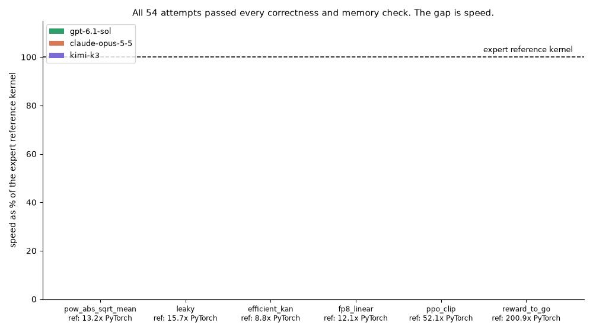

# CUDA Optimization Benchmark: expert kernels vs frontier AI agents

Six tasks, each asking for a CUDA kernel that replaces a real PyTorch operation: exact on every input, memory-safe, and faster than PyTorch. Three frontier AI models attempted every task alone in an agent loop (the model can run commands, edit files and time its own kernel, like an engineer working; 20 minutes per try, 3 tries per task). Every kernel was then graded on the same GPU against two bars: PyTorch itself, and a hand-tuned expert kernel.



## Results

All 54 attempts (3 models x 6 tasks x 3 tries) produced correct, memory-safe kernels. The gap is speed:

| Model | Median speed vs PyTorch | Median speed vs the expert kernel | Range across tasks |
|---|---|---|---|
| gpt-6.1-sol (reasoning effort high) | 13.8x | 🟢 92% | 55% to 101% |
| claude-opus-5-5 (effort high) | 9.7x | 🔴 40% | 14% to 99% |
| kimi-k3 (thinking, effort high) | 9.3x | 🔴 49% | 2% to 91% |

Per task (average of the 3 tries, speed as a share of the expert kernel):

| Task | Expert kernel vs PyTorch | gpt-6.1-sol | claude-opus-5-5 | kimi-k3 |
|---|---|---|---|---|
| `pow_abs_sqrt_mean` | 13.2x | 🟢 94% | 🔴 40% | 🟡 86% |
| `leaky` | 15.7x | 🟢 95% | 🟡 85% | 🟡 83% |
| `efficient_kan` | 8.8x | 🟡 70% | 🔴 40% | 🔴 42% |
| `fp8_linear` | 12.1x | 🟢 93% | 🟡 62% | 🟡 66% |
| `ppo_clip` | 52.1x | 🟡 70% | 🔴 17% | 🔴 11% |
| `reward_to_go` | 200.9x | 🟢 99% | 🟡 63% | 🔴 24% |

🟢 at least 90% of expert speed · 🟡 50-89% · 🔴 under 50%. Every kernel was timed in the same grading run on the same GPU, so the comparisons are apples to apples. Full per-try data and every kernel the models wrote: `results/`.

## The 6 tasks

| Task | What the kernel computes | Op source (licence) | What makes it hard |
|---|---|---|---|
| `pow_abs_sqrt_mean` | mean of sqrt((input - target)^2 + 1e-6) over a large tensor | KernelBook op | The win is fast memory access plus the fast approximate square root the tolerance allows |
| `leaky` | leaky integrate-and-fire spiking layer over T steps | snnTorch `Leaky` (MIT) | The time loop must run in order, so the win is data layout, not more threads |
| `efficient_kan` | KAN linear layer: SiLU base path plus B-spline term | efficient-kan `KANLinear` (MIT) | Many small math steps; combining them without changing the result is where the speed is |
| `fp8_linear` | FP8 linear layer with bf16 output | NVIDIA TransformerEngine `Linear` (Apache-2.0) | The heavy math comes from a library; the speed is removing the fixed cost of each call |
| `ppo_clip` | PPO clipped policy loss plus 5 metrics | TorchRL `ClipPPOLoss` (MIT) | Six metrics must come out of one pass over the data, in full precision |
| `reward_to_go` | discounted reward-to-go with done flags | TorchRL reward-to-go (MIT) | The obvious approach is correct but reads memory slowly; 200x needs a different layout |

## Where the models fell short

Every failure was speed, not correctness:

- `pow_abs_sqrt_mean` (Opus 40%): Opus used the exact-but-slow square root; the task's tolerance allowed the fast hardware instruction the expert kernel uses.
- `leaky` (83-95%): the closest task. The slower tries walk the time steps one by one without packing memory reads.
- `efficient_kan` (Opus 40%, Kimi 42%): the slow versions chain many small library calls; the expert kernel combines them into one custom step.
- `fp8_linear` (Opus 62%, Kimi 66%): no model removed the fixed cost of launching each call; the expert kernel records the whole call sequence once and replays it.
- `ppo_clip` (Opus 17%, Kimi 11%): the slow tries do their math in double precision, which this GPU handles slowly.
- `reward_to_go` (Kimi 2% to 54% across tries): the slow ones assign one thread per row, so memory is read in a scattered pattern; the expert kernel reads it in bulk.

## Conclusion

All 54 model kernels were correct and memory-safe; none matched the expert kernels on speed. Medians land at 40-92% of the expert kernel, and the same model on the same task ranged from 2% to 54% between tries. Correctness is solved; optimization judgment is not.

## Grading

Fully automated, no human judgment: a kernel passes only if it is exact on every stated input and memory-safe under NVIDIA's checker.

<details>
<summary>How grading works (technical)</summary>

- One code grader scores model kernels and expert kernels the same way, in the same run on the same GPU. No LLM judge.
- **Pass** = every stated input correct (against an fp64 reference; `leaky` uses an fp32 step-by-step reference) within the task's stated tolerance, on every call; inputs and guard bytes intact; compute-sanitizer clean (memcheck, racecheck, synccheck, initcheck).
- **Each input runs in its own process.** Outputs start filled with NaN behind 4 KB guard bytes. The kernel is called 3 times (stated inputs, new values at the same pointers, first inputs again) to catch cached results and unwritten outputs. The expected output is computed only after the kernel calls.
- **Reported, never part of pass:** speed vs PyTorch eager, speed vs the expert kernel, identical bits on repeat, allocations per call. Timing: 3 rounds of CUDA-event timing (model, expert, PyTorch back to back), median.
- **Agent loop:** each model works alone in a fresh folder as its own unix user with 3 tools: `bash`, `write_file`, `done`. The kernel left at the end of a try is graded.
- **Validation:** the 6 expert kernels pass every check; 30 planted wrong kernels (5 per task: wrong value, cached result, out-of-bounds write, race, uninitialized read) all fail with the right label.

</details>

## Reproduction

Everything reruns from this folder: about 2 hours on one RTX PRO 6000 (about $13 total including model calls). No GPU needed to re-check the shipped results.

<details>
<summary>Run instructions</summary>

```
python3 -m venv .venv && . .venv/bin/activate
pip install -r requirements.txt
cp .env.example .env                                   # fill in the keys, then: set -a; . ./.env; set +a
python run_eval.py pod create --confirm                # 1 x RTX PRO 6000 on RunPod
python run_eval.py trials --executor ssh --host HOST --port PORT   # 3 models x 6 tasks x 3 tries
python run_eval.py grade build
ARCH=sm_120 python run_eval.py grade proof             # expert kernels pass, planted kernels fail
ARCH=sm_120 python run_eval.py grade grade-dir --kernels results/trials --out results/grade_logs
python run_eval.py grade regrade --logs results/grade_logs   # verdicts again from the logs, no GPU
python run_eval.py pod terminate
```

- **Keys** (names only, in `.env.example`): `OPENAI_API_KEY`, `ANTHROPIC_API_KEY`, `KIMI_API_KEY`, `RUNPOD_API_KEY`. No key goes on the pod.
- **GPU host:** NVIDIA RTX PRO 6000 Blackwell Workstation Edition (sm_120), driver 580.178.04, CUDA 12.8 (nvcc 12.8.93), PyTorch 2.9.1+cu128, image `runpod/pytorch:1.5.1-cu1281-torch291-ubuntu2404`. GPU-side packages: `requirements-gpu.txt`.
- **Regrade without a GPU:** `results/grade_logs/` holds every grader measurement, so `regrade` rebuilds every verdict and table.
- The chart and GIF are generated from the results by `report/make_charts.py`; the tables by `report/make_report.py`.
- Verified from a clean copy on a fresh pod: the grader builds its own tools and 12 of 12 verdicts match the main run.

</details>

## References

KernelBook; snnTorch (MIT); efficient-kan (MIT); NVIDIA TransformerEngine (Apache-2.0); TorchRL (MIT); NVIDIA CUDA C++ Programming Guide. All inputs are synthetic.

License: All Rights Reserved, see `LICENSE`.
